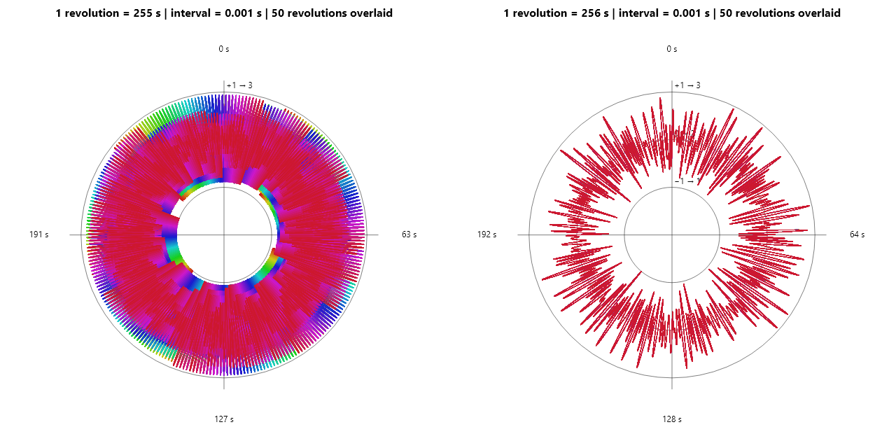

# Resonite SimplexNoise Period Visualization

This program visualizes the output of Resonite's installed
`SimplexNoise.Noise.Generate(float)` implementation as polar plots.

It compares different durations per revolution so the 256-unit repetition of
the one-dimensional noise function can be inspected visually. Each revolution
is plotted using a different opaque color.



## Requirements

- Windows
- .NET 10 SDK
- Resonite installed through Steam

The project references `Elements.Core.dll` from the local Resonite installation.
No Resonite DLL is included in this repository.

The default installation directory is:

```text
C:\Program Files (x86)\Steam\steamapps\common\Resonite
```

## Run

From the repository directory:

```powershell
dotnet run --project .\SimplexPeriodProof.csproj -- .\graph.png 2 1 255 256 50 0.001
```

This generates `graph.png` with:

- left plot: 255 seconds per revolution
- right plot: 256 seconds per revolution
- 50 revolutions overlaid
- 0.001-second sampling interval
- radius 2 when the noise output is 0
- radial extent 1, mapping noise outputs from -1 to +1 onto radii 1 to 3

When the revolution duration matches the 256-unit noise period, successive
revolutions occupy the same positions. Since the points are opaque, the last
drawn revolution can cover earlier revolutions. With a 255-second revolution,
successive revolutions are offset and their different colors remain visible.

## Arguments

```text
output radius-at-zero radial-extent left-seconds right-seconds revolutions interval-seconds
```

| Argument | Default | Description |
| --- | ---: | --- |
| `output` | `simplex-noise-polar-comparison.png` | Output PNG path |
| `radius-at-zero` | `2` | Radius used when the noise output is 0 |
| `radial-extent` | `1` | Distance from the zero radius for noise outputs -1 and +1 |
| `left-seconds` | `60` | Seconds represented by one revolution in the left plot |
| `right-seconds` | `256` | Seconds represented by one revolution in the right plot |
| `revolutions` | `5` | Number of revolutions overlaid in both plots |
| `interval-seconds` | `0.001` | Time between samples |

To use a non-default Resonite installation directory:

```powershell
dotnet run --project .\SimplexPeriodProof.csproj `
  -p:ResoniteDirectory='D:\Games\Resonite' -- `
  .\graph.png 2 1 255 256 50 0.001
```

## Plot mapping

For each sample:

```text
angle  = time within the current revolution
radius = radius-at-zero + Noise.Generate(time) * radial-extent
```

The plot contains points only; adjacent samples are not connected by lines.

## Related issue

[Wiggler / Wobbler3D movement stops when WorldTime × Speed + Seed becomes large](https://github.com/Yellow-Dog-Man/Resonite-Issues/issues/7327)
